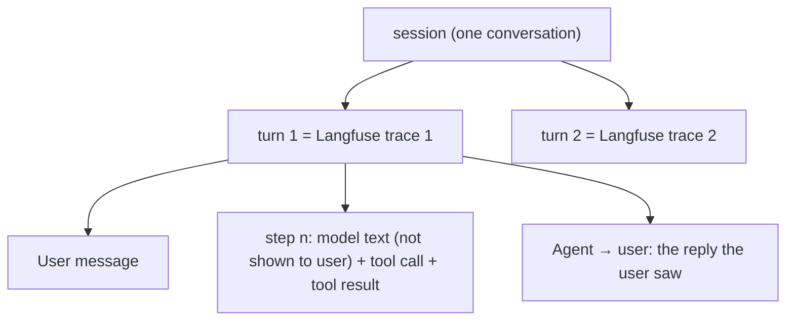

# HW4 review app

A session-grouped review interface for Cartwheel traces: open coding beside the evidence, a taxonomy view,
AI suggestions kept apart from human notes, and an explicit Pass/Fail label grid. Python standard library server,
one HTML file, no build step.

## Run (from the repository root)

```bash
uv run python -m analysis.review_app.load_traces   # pull support-* traces from Langfuse into a local cache
uv run python -m analysis.review_app.server        # open http://localhost:8030
uv run pytest analysis/review_app/test_review_app.py -q   # offline tests
```

`load_traces` uses Langfuse (canonical, keys from `.env`). If Langfuse is unavailable it falls back to
`traces/support_traces.json` and records the reason; the page shows a banner. The cache
(`analysis/review_app/cache/`) is not committed.

## What it shows



- **Conversation**: one session per screen, turns in time order, numbered step boxes, one-line result summaries
  with the full JSON on expand. Select text (or "+ note") to write an open code; "No failure observed" marks a
  clean review. Policy facts drawer (facts.yaml, store overrides, SPEC ids). The HW3 answer key unlocks only after a
  note exists for that conversation.
- **Taxonomy**: modes from `patterns.json` with definition, boundary, requirement, positives, close negatives,
  product change, revisions, and their supporting annotations; plus notes not yet grouped.
- **Labels**: reviewed conversation × mode grid. Fail = failure present (stored as 1).
- **Progress**: per-batch review counts, label gaps, sample fractions, modes first seen in the final batch.
- **Suggestions**: AI suggestions (purple, dashed) with Accept / Revise / Reject; every decision is kept.
- **Map**: PCA of structural features coloured by k-means cluster; reviewed and sampled points marked.

## Files it reads and writes

| File | Written by | Content |
|---|---|---|
| `analysis/state/sample_manifest.json` | agent (Part B) | `{"batches": [{"name", "method", "picks": [{"cid", "reason"}]}]}` |
| `analysis/state/annotations.json` | app | `{"annotations": [{id, trace_id (= cid), session_id, trace_ids, scenario_id, turn_trace_id, msg_key, quote, note, kind: failure \| no_failure, author: human, origin, batch, created_at, updated_at, history}]}` |
| `analysis/state/patterns.json` | agent, on the reviewer's decisions | `{"modes": [{name, status, definition, boundary, nearest_mode, requirement_source, evaluator_type, product_change, annotation_ids, created_from, example_trace_ids, close_negative_trace_ids, revisions}]}` |
| `analysis/state/suggestions.json` | agent proposes, app records decisions | `[{id, cid, msg_key, quote, mode, note, rationale, source, status, decision_reason, decided_at, annotation_id}]` |
| `analysis/state/label_proposals.json` | agent proposes (Part E), app records decisions | `[{id, cid, mode, label (pass/fail), group (1 Part D decision, 2 setup absent by an approved rule, 3 agent read), confidence, evidence, source, status (pending/accepted/flipped), decided_at}]`; a proposal becomes a label only when accepted (cell by cell, or per column for groups 1-2 via `POST /api/labels {"labels": [...]}`, one Langfuse flush) |
| `analysis/state/labels/<mode>.jsonl` | app (`POST /api/labels`) | append-only `{trace_id, label (1 = failure), source: human_hw4, ts, label_id, superseded_by?, session_id, trace_ids, scenario_id, evidence, langfuse_score}` |

The conversation id (`cid`) is the conversation's first Langfuse trace id. Labels are written to Langfuse as a
NUMERIC score named after the mode on that trace (`score_id = hw4-<mode>-<cid>`, so a relabel overwrites the
score), and kept locally. Free-text notes never create scores.

## Differences from the reference app (`analysis/server.py`, `analysis/ui/index.html`)

Retained: the file-backed JSON API, margin notes beside the evidence, a separate suggestion queue, the map.
Changed: session grouping, step boxes, reply vs interim text, policy drawer, locked answer key, labels only from the
explicit grid (the reference writes scores from annotations), append-only label files.
